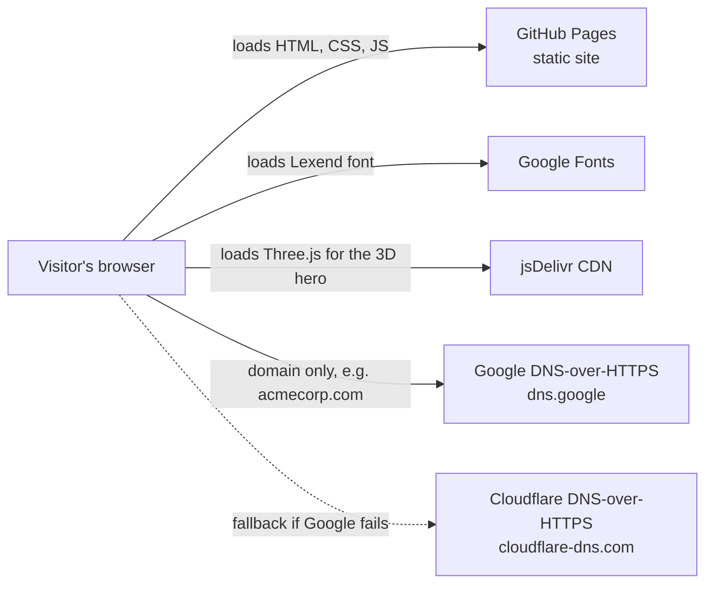
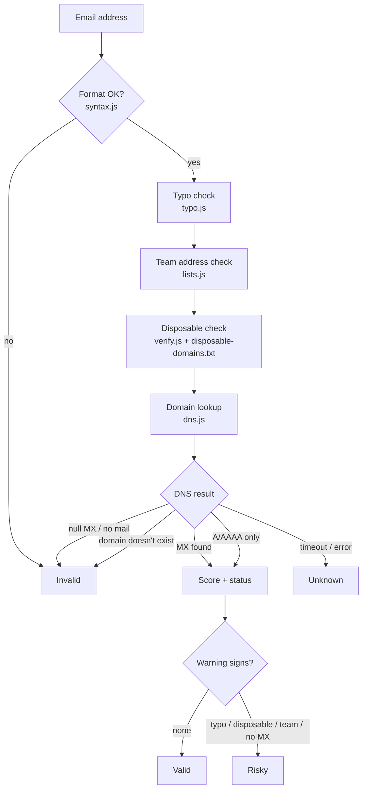
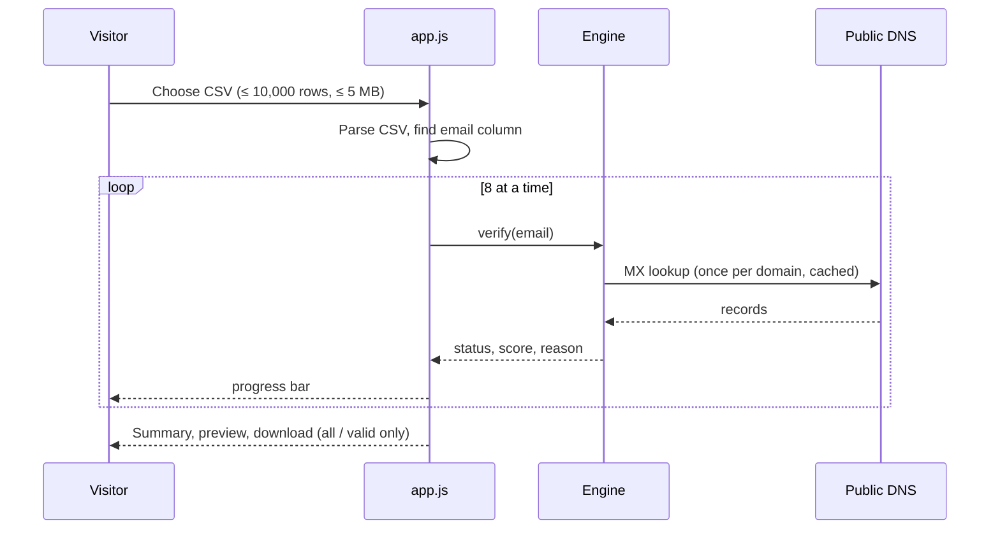
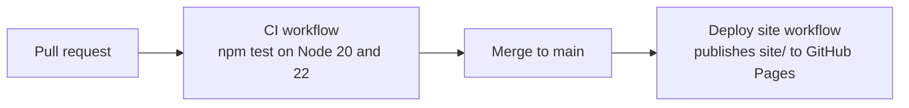
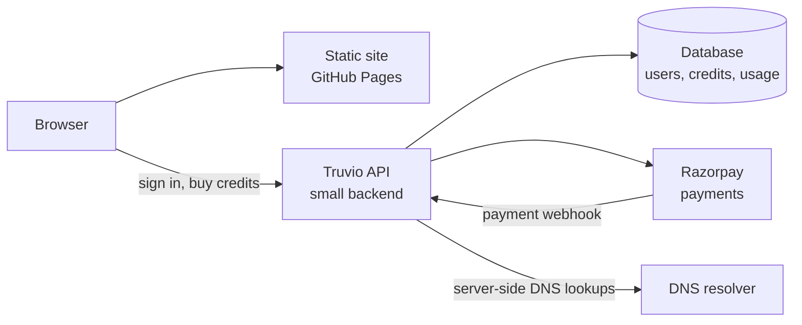
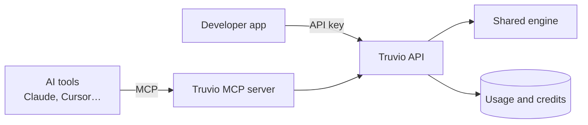

# Truvio — Architecture

This document explains how Truvio works today (Phase 1) and how it is planned to grow (Phases 2 and 3).

---

## 1. Phase 1 — browser-only (current)

Truvio is a **static website**. There is no Truvio server. All checks run in the visitor's browser, and the site is hosted for free on GitHub Pages.

### What runs where

| Part | Where it runs | Notes |
|---|---|---|
| Pages, styles, theme toggle | Browser | `site/*.html`, `assets/css/styles.css`, `assets/js/app.js` |
| 3D hero animation | Browser (WebGL) | `assets/js/scene.js`, Three.js 0.160.0. Pauses when off-screen; still frame for reduced motion; the page works without WebGL. |
| Verification engine | Browser (and Node for tests) | `assets/js/engine/*` — plain ES modules, no dependencies |
| Domain lookups | Google / Cloudflare public DNS | Only the part after the `@` is sent |
| Disposable domain list | Static file | `assets/data/disposable-domains.txt` (10,000+ domains, CC0) |
| CSV files | Browser memory | Never uploaded |

### The verification pipeline

**Scoring (0–100):** MX found starts at 95, address-record only at 75. Penalties: likely typo −40, disposable −60, team address −25. Invalid is 0.

### Engine modules

| File | Job |
|---|---|
| `syntax.js` | `checkSyntax()` — one @, allowed characters, length limits, extension, international domains (punycode) |
| `typo.js` | `suggestDomain()` — edit distance against common providers, plus extension fixes (`.con` → `.com`) |
| `lists.js` | Team addresses (`info@`, `sales@`…), free providers, typo targets |
| `dns.js` | `createDohResolver()` (Google first, Cloudflare fallback, timeout) and `checkMailDomain()` (MX → A/AAAA fallback → null MX → NXDOMAIN) |
| `verify.js` | `createVerifier()` combines everything into status, score, reason and suggestion; `runPool()` runs bulk checks 8 at a time |
| `csv.js` | Reads CSVs, finds the email column, writes results with formula-safe cells |

### Bulk check flow

### Privacy

- The full address never leaves the browser. Only the domain is sent to Google or Cloudflare DNS.
- No cookies, no analytics, no accounts.
- The only thing stored is the light/dark choice (`localStorage` key `truvio-theme`).

### Build, test and deploy

- `npm test` runs 31 tests with no network (DNS is faked).
- `npm run update:disposable` refreshes the disposable domain list.

### Limits of Phase 1

- Domain-level checks only. Truvio doesn't connect to mail servers (no SMTP mailbox check), so "valid" means the address and domain look deliverable.
- Speed depends on the visitor's connection and the public DNS services.
- No usage limits are enforced, because there is no server.

---

## 2. Phase 2 — accounts, credits and payments (planned)

Pricing is not decided yet. The site shows "Free during early access".

- A small backend handles sign-in, credit balances and payments.
- Razorpay for payments (Stripe India is invite-only).
- Free checks stay in the browser; paid bulk checks move to the server so limits and credits can be enforced.
- The same engine modules are reused on the server (they already run in Node).

## 3. Phase 3 — API keys and MCP server (planned)

- REST API with API keys and per-key rate limits.
- An MCP server so AI assistants can verify emails directly.
- Optional later: SMTP mailbox checks, if the hosting cost makes sense.

---

## For reference: how Neel's tool (MailSure) differs

| | Neel's tool | Truvio Phase 1 |
|---|---|---|
| Where checks run | His own server (Node's built-in `dns` module) | Visitor's browser (public DNS-over-HTTPS) |
| Third-party verification API | None | None |
| Bulk limit (website) | 50 emails, 2 MB | 10,000 rows, 5 MB |
| API rate limit | 30 req/min (site), 120 req/min (main API) | No API yet (Phase 3) |
| DNS timeout | 5,000 ms | Per-lookup timeout with Cloudflare fallback |

There is no 5,000-per-day or per-month allowance in his tool; the "5000" in his code is the DNS timeout in milliseconds.
