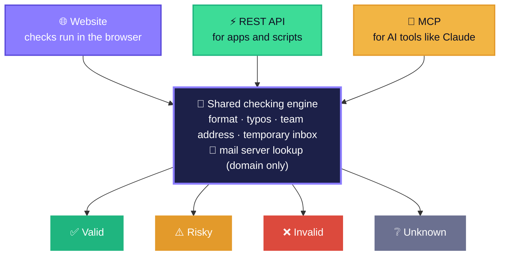
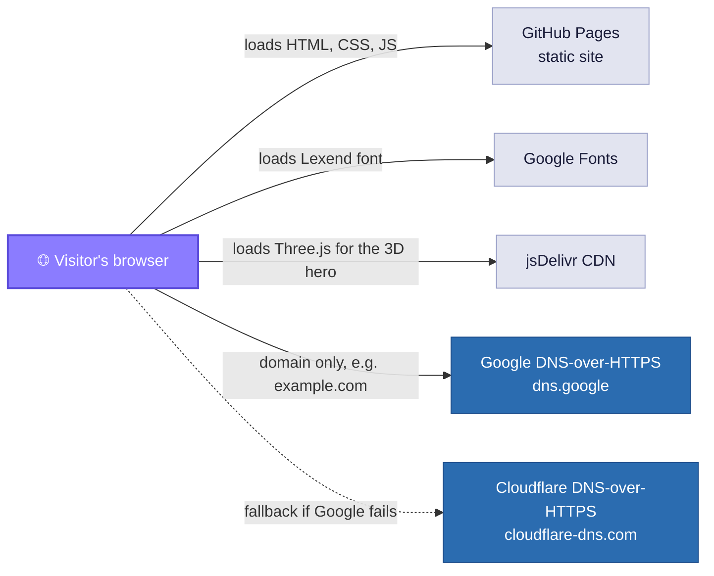
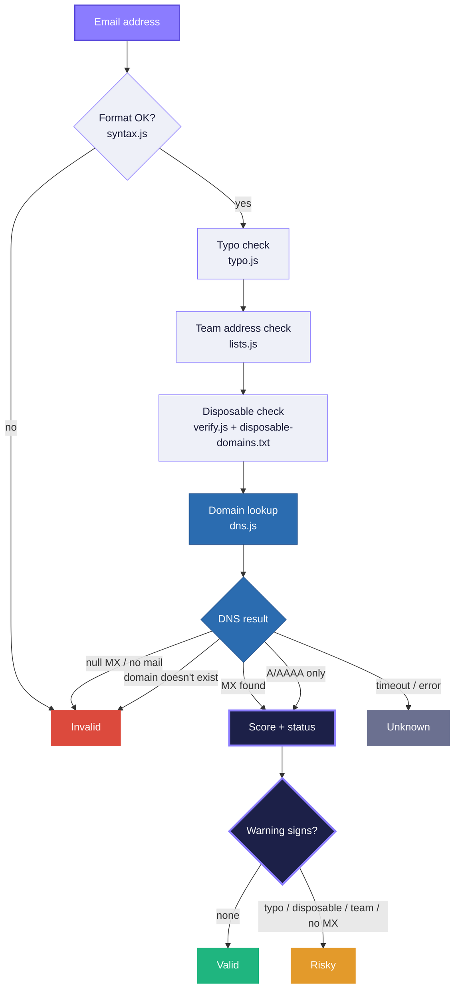
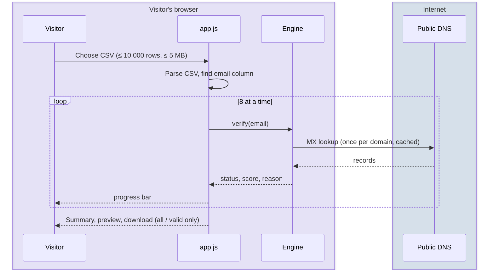
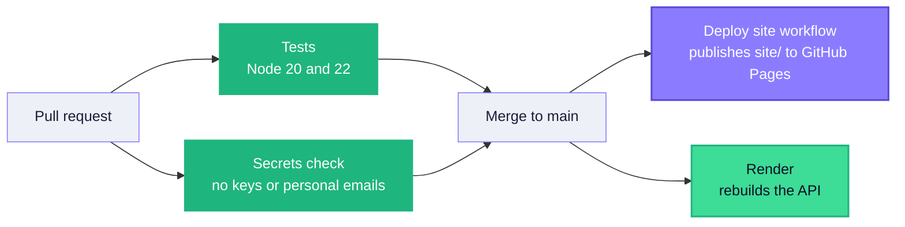
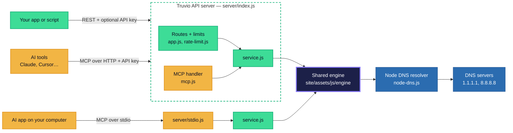
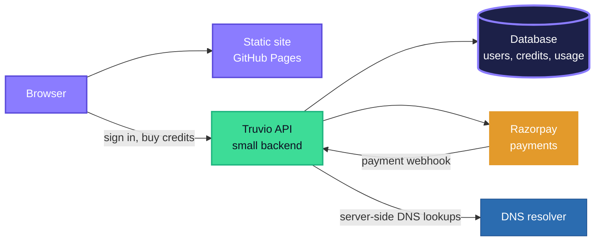

# Truvio — Architecture

Truvio has two parts that share one checking engine:

1. **The website** — static, on GitHub Pages; checks run in the visitor's browser.
2. **The API server** — a small Node.js server with a REST API and an MCP server for AI tools; checks run on the server with Node's built-in DNS.

This document covers both, and what comes next (accounts and payments).

**Colour key used in every diagram:** 🟪 website · 🟩 API · 🟨 AI tools (MCP) · 🟦 DNS · ⬛ shared engine · ⬜ outside services · results in 🟢 🟠 🔴 ⚪

---

## 1. The website (browser-only)

Truvio is a **static website**. There is no Truvio server. All checks run in the visitor's browser, and the site is hosted for free on GitHub Pages.

### What runs where

| Part | Where it runs | Notes |
|---|---|---|
| Pages, styles, theme toggle | Browser | `site/*.html`, `assets/css/styles.css`, `assets/js/app.js` |
| 3D hero animation | Browser (WebGL) | `assets/js/scene.js`, Three.js 0.160.0. Pauses when off-screen; still frame for reduced motion; the page works without WebGL. |
| Verification engine | Browser (and Node for tests) | `assets/js/engine/*` — plain ES modules, no dependencies |
| Domain lookups | Google / Cloudflare public DNS | Only the part after the `@` is sent |
| Disposable domain list | Static file | `assets/data/disposable-domains.txt` (10,000+ domains, CC0) |
| CSV files | Browser memory | Never uploaded |

### The verification pipeline

**Scoring (0–100):** MX found starts at 95, address-record only at 75. Penalties: likely typo −40, disposable −60, team address −25. Invalid is 0.

### Engine modules

| File | Job |
|---|---|
| `syntax.js` | `checkSyntax()` — one @, allowed characters, length limits, extension, international domains (punycode) |
| `typo.js` | `suggestDomain()` — edit distance against common providers, plus extension fixes (`.con` → `.com`) |
| `lists.js` | Team addresses (`info@`, `sales@`…), free providers, typo targets |
| `dns.js` | `createDohResolver()` (Google first, Cloudflare fallback, timeout) and `checkMailDomain()` (MX → A/AAAA fallback → null MX → NXDOMAIN) |
| `verify.js` | `createVerifier()` combines everything into status, score, reason and suggestion; `runPool()` runs bulk checks 8 at a time |
| `csv.js` | Reads CSVs, finds the email column, writes results with formula-safe cells |

### Bulk check flow

### Privacy

- The full address never leaves the browser. Only the domain is sent to Google or Cloudflare DNS.
- No cookies, no analytics, no accounts.
- The only thing stored is the light/dark choice (`localStorage` key `truvio-theme`).

### Build, test and deploy

- `npm test` runs 45 tests (engine, API, MCP) with no network (DNS is faked).
- `npm run update:disposable` refreshes the disposable domain list.

### Limits of the website

- Domain-level checks only. Truvio doesn't connect to mail servers (no SMTP mailbox check), so "valid" means the address and domain look deliverable.
- Speed depends on the visitor's connection and the public DNS services.
- The website itself has no usage limits (there is no server behind it). The API has limits — see below.

---

## 2. The API server (live)

The same engine, running on a server, so apps, scripts and AI tools can check emails. Like MailSure, it uses **Node's built-in `dns` module** — no third-party verification API and no npm packages.

### Endpoints

| Endpoint | What it does |
|---|---|
| `GET /v1/verify?email=` · `POST /v1/verify` | Check one address |
| `POST /v1/verify/batch` | Check a list; results keep the input order, plus a summary |
| `GET /v1/domain?domain=` | Check a domain: exists, accepts email, MX hosts, disposable, free provider |
| `POST /mcp` | MCP (JSON-RPC) for AI tools — tools `verify_email`, `verify_emails_batch`, `check_domain` |
| `GET /health` · `GET /version` · `GET /` | Health check, version, endpoint list |

### Access and limits

| | Without a key | With an API key |
|---|---|---|
| Requests per minute | 30 per IP address | 120 per key |
| Emails per batch | 50 | 500 |
| MCP over HTTP | No | Yes |

All numbers are settings (`.env.example`). `TRUVIO_PUBLIC_ACCESS=false` makes a key required everywhere. Keys are sent as `Authorization: Bearer <key>` or `X-API-Key`, and compared in constant time.

### Capacity (measured on the live API, free Render plan)

- 50 emails with 50 different domains: **0.47 s** (about 100 emails a second).
- 50 emails over 8 common domains: **0.007 s** — each domain is looked up once and cached for 10 minutes.
- Ceilings: without a key **1,500 emails/min** per user; with a key **~6,000/min** (every domain new) up to the **60,000/min** limit (typical lists). The free server is shared and sleeps after 15 minutes idle.

### Server modules

| File | Job |
|---|---|
| `server/index.js` | Starts the HTTP server, graceful shutdown |
| `server/app.js` | Routes, API keys, CORS, JSON body limits, error format, request log (path only) |
| `server/rate-limit.js` | Per-IP / per-key limits (in memory) |
| `server/service.js` | `verifyEmail`, `verifyEmails` (10 at a time), `checkDomain` |
| `server/node-dns.js` | Node DNS lookups → same `{status, records}` shape as the browser resolver |
| `server/mcp.js` | MCP tools and JSON-RPC handling |
| `server/stdio.js` | MCP over stdin/stdout for local AI apps |
| `server/config.js` | Settings from environment variables |

### Safety and privacy

- Email addresses are never logged or stored. Logs hold method, path, status and time only.
- Domain results are cached for 10 minutes (up to 50,000 domains) to keep it fast and polite to DNS servers.
- Request bodies are limited to 1 MB; only JSON is accepted on POST.
- Browsers can call the API only from allowed sites (CORS list).
- No mailbox (SMTP) checks — same as the website.

### Hosting

- `Dockerfile` — Node 22 Alpine image, runs as a non-root user, built-in health check.
- `render.yaml` — Render Blueprint (free plan works, same host as MailSure). It creates one API key automatically.
- Runs anywhere Docker or Node 20+ runs (Railway, Fly.io, Google Cloud Run…).
- Limits are kept in memory, so run **one** instance until Phase 3 moves them to a shared store.

---

## 3. Next — accounts, credits and payments (planned)

Pricing is not decided yet. The site shows "Free during early access".

- A small backend handles sign-in, credit balances and payments.
- Razorpay for payments (Stripe India is invite-only).
- Free checks stay in the browser; paid bulk checks use the API so credits can be counted.
- API keys move from an environment variable to the database, with a page to create and revoke them.
- Rate-limit counters move to a shared store so the API can run on several servers.

Optional later: SMTP mailbox checks, if the hosting cost makes sense.

---

## For reference: how MailSure differs

| | MailSure | Truvio |
|---|---|---|
| Where checks run | Its own server (Node's built-in `dns` module) | Website: visitor's browser. API: our server (Node's built-in `dns` module) |
| Third-party verification API | None | None |
| Bulk limit (website) | 50 emails, 2 MB | 10,000 rows, 5 MB |
| API rate limit | 30 req/min (site), 120 req/min (main API) | 30 req/min without a key, 120 req/min with a key |
| API batch size | 50 (site), up to 500 (main API) | 50 without a key, 500 with a key |
| MCP for AI tools | Yes (HTTP and stdio) | Yes (HTTP and stdio) |
| npm packages | Express, MCP SDK, SQLite, Zod… | None (Node built-ins only) |
| DNS timeout | 5,000 ms | 5,000 ms, 2 tries (configurable) |

MailSure has no 5,000-per-day or per-month allowance; the "5000" in its code is the DNS timeout in milliseconds.
