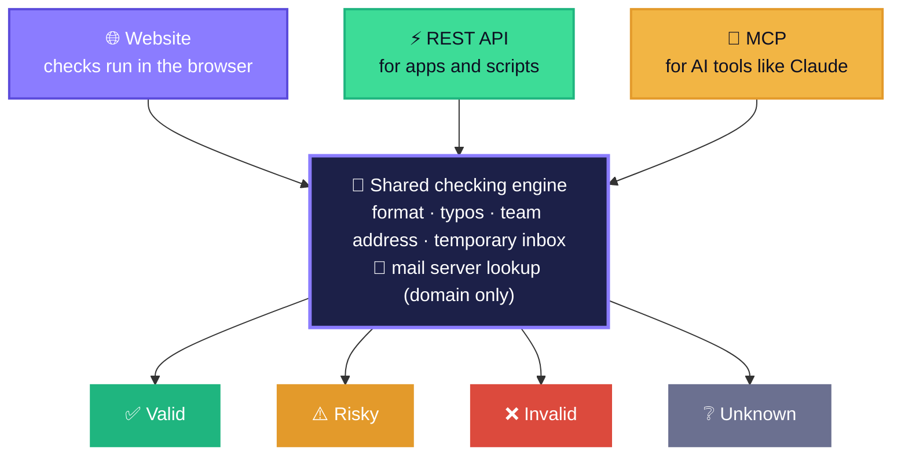

<div align="center">


<br><br>

[](https://nexoradev-stack.github.io/Email-Chekkr/)
[](https://email-chekkr-api.onrender.com/health)
[](#-mcp-ai-tools)
[](https://github.com/nexoradev-stack/Email-Chekkr/actions/workflows/ci.yml)


[🌐 Website](https://nexoradev-stack.github.io/Email-Chekkr/) · [⚡ API docs](https://nexoradev-stack.github.io/Email-Chekkr/api.html) · [🏗️ Architecture](ARCHITECTURE.md) · [🚀 Run it locally](#-run-it-locally) · [🗺️ Roadmap](#️-roadmap) · [🙌 Credits](#-credits)

</div>

---

## ✨ What it does

Paste an address, upload a CSV of up to 10,000 rows, call the API, or ask your AI assistant. Every address gets a result and a score from 0 to 100.

| Check | What it looks for |
|---|---|
| ✍️ **Format** | One @, allowed characters, length limits, a real extension. International domains are supported. |
| 🌍 **Domain** | The domain exists. |
| 📮 **Mail server** | The domain has a mail server (MX record, or at least an address record) and hasn't opted out of email (null MX). |
| ⏳ **Temporary inbox** | Not one of 10,000+ known disposable services. |
| 👥 **Person or team** | Not a team inbox like `info@`, `sales@` or `support@`. |
| 🔤 **Typos** | `gmial.com` → "did you mean `gmail.com`?", `company.con` → `company.com`. |

---

## 🧭 How it works



- 🌐 **Website:** checks run in the visitor's browser. CSV files are never uploaded. Lookups go to Google Public DNS (Cloudflare as a fallback).
- ⚡ **API and 🤖 MCP:** a small Node.js server on Render that runs the same engine and uses Node's built-in DNS. No third-party verification service.
- 🔒 **Privacy:** only the domain (for example `example.com`) is ever looked up — never the full address. The API never stores or logs addresses.
- 🧾 **Safe downloads:** results are added as new CSV columns (`chekkr_status`, `chekkr_score`, `chekkr_reason`, `chekkr_suggestion`). Cells starting with `=`, `+`, `-` or `@` are escaped so spreadsheets don't run them as formulas.

Full details, with a diagram for every part, are in **[🏗️ ARCHITECTURE.md](ARCHITECTURE.md)**.

---

## 🚦 Results

| Result | Meaning |
|---|---|
| 🟢 **Valid** | Well-formed, the domain has a mail server, no warning signs. |
| 🟠 **Risky** | Takes email, but something's off: temporary inbox, team address, likely typo, or no MX record. |
| 🔴 **Invalid** | Badly formed, or the domain doesn't exist or doesn't accept email. |
| ⚪ **Unknown** | The domain didn't answer in time. Check again later. |

> [!NOTE]
> Email Chekkr doesn't log in to mail servers, so **"valid" means the address and its domain look deliverable**, not that the exact mailbox was confirmed.

---

## ⚡ API in 10 seconds

```bash
curl "https://email-chekkr-api.onrender.com/v1/verify?email=sample.user@gmial.com"
```

| Endpoint | What it does |
|---|---|
| `GET /v1/verify?email=` · `POST /v1/verify` | Check one address |
| `POST /v1/verify/batch` | Check a list (`{"emails": [...]}`) |
| `GET /v1/domain?domain=` | Check a domain |
| `POST /mcp` | MCP for AI tools (needs an API key) |
| `GET /health` | Health check |

| | Without a key | With an API key 🔑 |
|---|---|---|
| Requests per minute | 30 per IP | 120 per key |
| Emails per request | 50 | 500 |
| AI tools (MCP) | — | ✅ |

Send the key as `Authorization: Bearer <key>` (or `X-API-Key`). Full docs: **[API page](https://nexoradev-stack.github.io/Email-Chekkr/api.html)**.

### 📊 Capacity

Measured on the live API (free Render plan): **50 emails with 50 different domains in 0.47 s**, about 100 emails a second. Repeated domains (like `gmail.com`) are near-instant because each domain is remembered for 10 minutes.

| | Per minute | Per day | Per month (30 days) |
|---|---|---|---|
| 🔓 API, no key (per user) | 1,500 | 2.16 million | 64.8 million |
| 🔑 API key — every domain new | ~6,000 | ~8.6 million | ~259 million |
| 🔑 API key — typical lists (up to the limit) | 60,000 | 86.4 million | 2.59 billion |
| 🌐 Website (in the browser) | ~3,000–6,000 *(estimate)* | no limit | no limit |

Day and month figures assume non-stop use. The free server is shared by everyone and sleeps after 15 minutes idle (the first request then takes ~50 s). For heavy use, upgrade the Render instance.

### 🤖 MCP (AI tools)

Tools: `verify_email`, `verify_emails_batch`, `check_domain`.

- **Remote:** `https://email-chekkr-api.onrender.com/mcp` with `Authorization: Bearer <API key>`.
- **Local:** `npm run mcp` (stdio). Example config: [`examples/mcp-config.json`](examples/mcp-config.json).

### ☁️ Deploy the API

**Render (free plan):** Render → New → Blueprint → pick this repo. It uses [`render.yaml`](render.yaml) and the [`Dockerfile`](Dockerfile), and creates an API key for you (email-chekkr-api → Environment).
Anything that runs Docker or Node 20+ works too (Railway, Fly.io, Google Cloud Run). All settings are environment variables — see [`.env.example`](.env.example).

### 🔐 Keys and secrets

- API keys live **only** in the host's environment settings (on Render: email-chekkr-api → Environment → `EMAIL_CHEKKR_API_KEYS`). They are never stored in this repository.
- `.env` files are ignored by git. `.env.example` lists the settings with no real values.
- Every push and pull request runs `npm run check:secrets`, which fails if a key, token or personal email address is found.
- All email addresses in the code, docs and tests are made-up samples.

---

## 🎨 Design

- **Colours:** Night Blue `#040A18`, 66° White `#FFFDF9`, Shark Grey `#B3C5D0` and 66° Blue `#3952FF`, with neutrals `#F3F2F0` `#ECECEC` `#E2E4E7` `#DBDDE1`. Green, amber and red appear only on results.
- **Fonts:** [Inter](https://fonts.google.com/specimen/Inter) at weights 400 and 500 (no heavy bold), and [IBM Plex Mono](https://fonts.google.com/specimen/IBM+Plex+Mono) for small labels and code.
- **Logo:** a 66° Blue sphere with a white tick inside a Night Blue rounded square (`site/assets/img/logo.svg`; flat version for the favicon).
- **Light and dark mode:** follows the visitor's system setting, with a sun/moon toggle on every page. The choice is remembered in the browser.
- **Hero:** a spinning globe with orbit rings and floating result chips, made in CSS only (no WebGL). It stops moving for visitors who prefer reduced motion.

---

## 🚀 Run it locally

Needs Node.js 20+ and Python 3 (for the website preview server). No `npm install` needed.

```bash
npm test                 # 45 tests: engine, API, MCP (no network needed)
npm run check:secrets    # scan for keys and personal emails
npm run serve            # website at http://localhost:8080
npm start                # API at http://localhost:8787
npm run mcp              # MCP server over stdio
npm run update:disposable  # refresh the disposable domain list
```

### 🌐 Publish the website

1. Repo **Settings → Pages → Source: GitHub Actions** (one time — done).
2. Merge to `main`. The **Deploy site** workflow publishes the `site/` folder.
3. Live at **https://nexoradev-stack.github.io/Email-Chekkr/**

---

## 📁 Project structure

```text
site/                       the website (published to GitHub Pages)
├── index.html              home: single check, what we check, result guide, FAQ
├── bulk.html               bulk CSV check
├── pricing.html            plans and waitlist form
├── api.html                API and MCP docs
├── contact.html            contact form
├── privacy.html  terms.html  404.html
└── assets/
    ├── css/styles.css
    ├── js/app.js           page behaviour, theme toggle, forms
    ├── js/config.js        form settings (Web3Forms access key)
    ├── js/engine/          the checking engine (runs in browsers and Node)
    │   ├── syntax.js       format rules
    │   ├── typo.js         "did you mean …?" suggestions
    │   ├── dns.js          DNS-over-HTTPS lookups and MX logic
    │   ├── verify.js       combines the checks into a result and score
    │   ├── lists.js        team addresses, free providers, typo targets
    │   └── csv.js          CSV reading/writing
    ├── data/disposable-domains.txt
    ├── data/email-chekkr-sample.csv
    └── img/                logo.svg, favicon.svg, icon-512.png
server/                     the API and MCP server (Node built-ins only)
├── index.js                starts the HTTP server
├── app.js                  routes, API keys, CORS, limits
├── service.js              verify one, verify many, check domain
├── node-dns.js             DNS lookups with Node's dns module
├── mcp.js  stdio.js        MCP tools; MCP over stdin/stdout
└── rate-limit.js  config.js  runtime.js
docs/assets/banner.svg      README banner
examples/                   MCP config and API request examples
scripts/                    disposable list refresh, secrets check
test/                       engine, API and MCP tests
Dockerfile  render.yaml  .env.example
ARCHITECTURE.md             how it all works, with diagrams
```

---

## 🗺️ Roadmap

| Phase | What | Status |
|---|---|---|
| 1 | 🌐 Website: single and bulk checks in the browser | ✅ Live |
| 2 | ⚡ REST API and 🤖 MCP server for AI tools | ✅ Live |
| 3 | 💳 Accounts, credits and payments (Razorpay), API keys in a database | 🕒 Planned — pricing to be confirmed |

---

## 🙌 Credits

| Contributor | Role |
|---|---|
| 👤 **[nexoradev-stack](https://github.com/nexoradev-stack)** | Owner, product and design direction |
| 🤖 **Claude** (Anthropic) | Code, design and docs |
| 🖱️ **Cursor** | AI code editor |

Disposable domain data: [disposable-email-domains](https://github.com/disposable-email-domains/disposable-email-domains) (CC0 1.0, public domain).

## 📄 Licence

© 2026 Email Chekkr. All rights reserved. The source is published for transparency; no licence to reuse it is granted.
